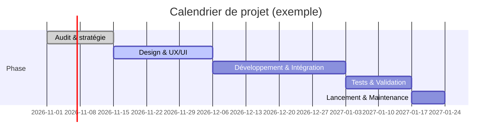

# Plan de création du site web de l’association « Art Sous Le Manguier »

## Résumé exécutif

L’association **Art Sous Le Manguier** est un projet culturel camerounais, initié par la curatrice-artiviste Louise Abomba. Son activité principale est une émission vidéo documentaire (« Art sous le Manguier ») lancée en 2017 à Douala (sous un manguier du lieu d’art Doual’art) visant à valoriser les artistes contemporains et à construire la mémoire collective culturelle. L’association n’a pas de site public complet actuellement (un site « en construction » affiche seulement un logo et des liens vers LinkedIn, Instagram, Facebook). Pour leur site web, nous recommandons une architecture claire (« À propos / Mission », « Émissions (vidéos) », « Projets & Événements », « Actualités », « Partenaires », « Contact / Faire un don »), un design sobre et épuré reprenant la charte existante (logo vert/marron-gris de l’association), et des fonctionnalités essentielles (CMS adapté, responsive, SEO, formulaires, billetterie/dons en ligne, newsletter). Des outils techniques tels que WordPress ou un site statique (ex. Hugo/Eleventy) sont à comparer. Nous proposons un planning en phases (audit/stratégie, design, développement, tests) visualisé en diagrammes, ainsi qu’un ensemble de prompts détaillés (en français) pour guider un agent IA dans la conception du design system, des composants (HTML/CSS/JS, React/Vue, etc.), des pages types et des images (Stable Diffusion, DALL·E). Enfin, un tableau de fonctionnalités prioritaires vs secondaires et une checklist de livrables garantissent l’atteinte des objectifs qualité et stabilité.

## Présentation de l’association

L’association **Art Sous Le Manguier** est active dans le milieu culturel camerounais. Bien que sa ville d’origine ne soit pas explicitement précisée dans les sources accessibles, plusieurs références indiquent Douala (notamment le lieu de tournage « Doual’art » à Bonanjo, Douala). L’échelle exacte (locale vs régionale) reste à vérifier sur place, mais on supposera Douala, Cameroun, comme base opérationnelle. L’association a une présence sur les réseaux sociaux (LinkedIn, Instagram, Facebook comme indiqué sur le site en maintenance) et collabore avec des structures culturelles locales : par exemple, elle est mentionnée comme partenaire de l’incubateur créatif camerounais Up High Lab. 

**Identité et logo existant :** Le logo actuel, visible sur la page d’attente du site web, est constitué d’un pictogramme de manguier stylisé et des initiales « ASM » en vert, sur fond clair. Ce logo combine le symbole du manguier (en vert) avec une typographie sans-serif moderne en gris, véhiculant une image naturelle, sobre et contemporaine. Ces éléments de charte graphique (palette verte/grise, silhouette d’arbre, typographie épurée) seront conservés et éventuellement étendus à l’ensemble du site (par exemple avec des tons verts pour accentuer certains boutons ou en-têtes).

 *Figure : Exemple du logo actuel d’Art Sous Le Manguier (capturé sur le site en construction). Ce visuel associe un manguier stylisé vert et les initiales « ASM », sur fond clair. La charte se veut sobre, naturelle et épurée.*

## Historique, mission et activités

Art Sous Le Manguier a été fondée par Louise Abomba, une curatrice et productrice culturelle camerounaise. L’émission vidéo **« L’Art sous le Manguier »** a débuté en 2017 sous un manguier dans l’enceinte de Doual’art (Bonanjo, Douala). Initialement conçue comme un tournage informel, l’émission a rapidement été formalisée : en 2022, 54 épisodes avaient été diffusés. L’objectif déclaré est de **favoriser la visibilité des artistes contemporains camerounais** et de sauvegarder leurs travaux. Selon les propos de Louise Abomba, le projet est un « devoir pour la mémoire collective » visant à montrer des « référents pour avoir des références », c’est-à-dire à établir des figures artistiques reconnues dans le temps.

Concrètement, l’association produit des émissions vidéo d’environ 20 minutes dans lesquelles Louise Abomba interviewe des plasticiens, peintres, sculpteurs, curateurs, etc., sur son « plateau sous le manguier ». Le format est flexible (quelques épisodes ont présenté un seul artiste, d’autres plusieurs). En parallèle, l’association organise ou participe à des événements culturels : par exemple, Louise Abomba a animé des rencontres publiques lors du festival DOMAF à Douala et résidences d’artistes (voir section Projets plus bas). Elle est également engagée dans des projets connexes tels que *Lecture chantée* (promotion de la lecture) et divers ateliers, comme mentionné dans sa biographie. 

### Projets et événements notables

- **Émissions « L’Art sous le Manguier » (saisons 1–6)** : Série vidéo mensuelle (environ un épisode par mois) diffusée sur Facebook et YouTube (premier épisode de la saison 6 mis en ligne le 5 août 2023).  
- **Rhizomes Mag** : Une série de rencontres (format vidéo ou podcasts) imaginée par Art Sous le Manguier pour découvrir des acteurs culturels émergents (réseaux sociaux mentionnent ce programme).  
- **Ateliers & résidences (2024–2025)** : Louise Abomba a co-animé des ateliers d’arts visuels lors de la biennale DOMAF à Douala (ex : cabinet de curiosités, Domaf 2024) et a participé à des résidences artistiques (ex : « Immersion » festival Afropolitain Nomade à Montréal, fév. 2025). Ces activités élargissent le rayonnement de l’association au-delà du simple web, en favorisant l’échange culturel international.  
- **Publications et projets parallèles** : Elle est également co-éditrice ou curatrice de projets comme des publications sur l’art, renforcement des archives audiovisuelles des artistes, etc. (d’après son CV/biographie).

### Public cible, partenaires et financements

Le public visé par Art Sous Le Manguier comprend principalement les **artistes et amateurs d’art contemporain africain**, les acteurs culturels (étudiants en arts, galeristes, curateurs) et le grand public intéressé par la culture camerounaise. L’émission s’adresse aussi aux jeunes créateurs qui n’ont pas encore de visibilité, en les mettant en contact avec des aînés reconnus (comme Louise Abomba le décrit). 

Parmi les partenaires identifiés figurent :
- **Doual’art (Douala, Cameroun)** : lieu d’art contemporain où est née l’émission. Doual’art a probablement soutenu la production (prêt de lieu et communication).  
- **Up High Lab (Douala)** : incubateur d’entreprises créatives, qui cite Art Sous le Manguier comme partenaire (« trouver son don, le développer et le transmettre »).  
- **Festivals et institutions culturelles** : Centre Culturel Français (CCF), DOMAF (Douala Manga Festival), Fidékom (COMIC’ART), ou ONG culturelles locales qui organisent des événements. (Ces connexions sont suggérées par les activités de Louise Abomba dans la communauté artistique, mais demanderaient vérification précise.)  

Les sources de financement ne sont pas publiquement détaillées. On peut supposer un modèle mixte : subventions culturelles (pouvoirs publics camerounais, bailleurs internationaux), mécénat d’entreprises culturelles, revenus possibles liés à des ateliers payants ou partenariats. Le budget étant inconnu, il faudra prévoir des solutions techniques économiques et évolutives pour le site (par ex. hébergement partagé ou cloud modulaire, CMS open-source).

## Contenus nécessaires pour le site

Pour représenter fidèlement l’association et soutenir ses activités, le site web devra regrouper les contenus suivants :  

- **Page d’accueil** : brève présentation/motto de l’association, visuels forts (photos d’ateliers sous le manguier), derniers épisodes vidéos en vedette, actualités récentes, appel à action (newsletter, dons, réseaux sociaux).  
- **Qui sommes-nous (À propos)** : historique succinct, mission déclarée (visibilité des artistes, mémoire collective), bio de la fondatrice, éventuellement membres clés ou conseils d’administration si existant. (Transformer en textes clairs les citations de Louise Abomba sur la mission.)  
- **Émissions / Médias** : page ou section dédiée aux vidéos « Art sous le Manguier ». Un lecteur vidéo intégré (YouTube ou serveur local) pour chaque épisode, avec titre, date, description, invités. Possibilité de filtrer par saison ou artiste. Téléchargements de PDF/texte accompagnant l’épisode si disponibles.  
- **Projets & Événements** : description des autres initiatives (expositions, ateliers, résidences). Un calendrier interactif (ou une page « Agenda ») listant les prochains événements ou workshops. Si billetterie nécessaire (si organisation d’événements payants), intégration de module d’achat ou lien vers plateforme externe.  
- **Actualités / Blog** : articles courts sur les dernières réalisations, nouvelles interviews, appels à candidatures, communiqués (possibilité de republier les posts Facebook/informations plus formelles). Permet une communication continue.  
- **Partenaires & Sponsors** : logos et descriptions des institutions partenaires (ex : Up High Lab, Doual’art, mécènes).  
- **Nous soutenir / Dons** : page expliquant comment soutenir l’association (dons financiers, mécénat, bénévolat) avec formulaire de don en ligne (virement/CBS ou bouton Stripe/Paypal, selon la solution de paiement adoptée).  
- **Contact** : formulaire de contact (Nom, e-mail, message), liste des coordonnées (e-mail, téléphone, adresse physique présumée à confirmer). Liens vers réseaux sociaux. Intégrer newsletter (champ d’inscription) pour recueillir des abonnés.  

**Médias visuels** : Photographies des émissions (Louise interviewant sous le manguier, œuvres d’art), logos, illustrations (ex : esquisse de manguier en filigrane), vidéos promotionnelles. Il est crucial de disposer de visuels de haute qualité (libres de droits ou réalisés par l’association) pour agrémenter le site sans le surcharger. Un accent visuel minimaliste (grand fond clair, touches de vert) sera privilégié pour coller au style « sobre et épuré ».

## Identité visuelle recommandée

L’identité visuelle doit s’appuyer sur le logo existant et évoquer l’art, la nature (manguier) et la sobriété. Recommandations :  
- **Palette de couleurs** : utiliser des nuances de vert (comme le logo) pour les accents (boutons, liens, titres de section) et des tons neutres (gris foncé #333, blanc cassé) en arrière-plan. Par exemple, #006633 pour le vert principal, #555555 pour texte sombre, fonds blancs.  
- **Typographie** : police sans-serif moderne (ex. *Montserrat*, *Lato*, *Open Sans* ou *Helvetica Neue*) pour titres et corps de texte, afin d’assurer lisibilité et épure. Possibilité de jouer sur les graisses (light pour textes, bold pour titres) pour structurer visuellement.  
- **Logo et iconographie** : intégrer le logo « ASM » en en-tête et pied de page. Utiliser éventuellement une version simplifiée (silhouette de feuille) comme favicon. Des icônes linéaires simples (dessin d’arbre, caméra, calendrier, réseaux sociaux) pour renforcer l’aspect visuel sans charger la page.  
- **Photos & illustrations** : privilégier des images avec des espaces vides pour la superposition de texte, éviter les motifs trop chargés. Si besoin, appliquer un filtre léger (passe-gaussian ou bicolore vert/gris) pour cohérence. L’ensemble doit respirer et non concurrencer le contenu textuel.  

L’objectif est un design épuré, aéré, où la charte graphique naturelle reflète le thème du manguier, sans encombrement graphique. Le site doit inspirer confiance et professionnalisme (pour attirer mécènes et partenaires) tout en restant chaleureux et accessible au public francophone africain.

## Architecture de l’information (arborescence)

Nous proposons l’arborescence hiérarchique suivante (exemple de contenu pour chaque page) :  

| Page / Section       | Contenu principal                                                                                                                     |
|----------------------|--------------------------------------------------------------------------------------------------------------------------------------|
| **Accueil**          | Brève présentation de l’association, slider ou vidéo d’intro, derniers épisodes en avant, actualités principales, appels à action.   |
| **À propos**         | Historique, mission (citation clé ), équipe (Louise Abomba, etc.), associations partenaires.                             |
| **Émissions**        | Liste des épisodes vidéo « Art sous le Manguier » par saison, lecteurs intégrés, descriptions et interviews complètes.                |
| **Projets & Événements** | Descriptions des projets phares (ateliers, expositions, « Rhizomes Mag », résidences). Calendrier des prochains événements.         |
| **Actualités / Blog**   | Articles de blog, annonces culturelles, publications récentes, avec système d’archivage par date ou catégorie.                      |
| **Partenaires**       | Logos et descriptions brèves des partenaires (Up High Lab, Doual’art, mécènes, soutiens institutionnels).                |
| **Nous soutenir (Dons)** | Page explicative + formulaire de don en ligne. Informations sur la newsletter, adhésion ou bénévolat si applicable.              |
| **Contact**          | Formulaire de contact, coordonnées, carte Google Map (si adresse physique), liens réseaux sociaux.                                     |
| **Bas de page (footer)** | Mentions légales (CRF), conditions d’utilisation, petits liens utiles (site map, politique de confidentialité).                  |

Cette structure permet un parcours clair : l’utilisateur arrive sur l’accueil pour se faire une idée globale (et visionner un ou deux médias), puis peut naviguer vers les sections détaillées. Par exemple, un artiste découvrant le site pourra aller directement dans « À propos » pour comprendre la mission, puis dans « Émissions » pour voir les vidéos, ou encore dans « Projets » pour s’inscrire à un atelier. 

Le schéma suivant illustre l’architecture proposée :

```mermaid
graph LR
  A[Accueil] --> B[À propos]
  A --> C[Émissions (vidéos)]
  A --> D[Projets & Événements]
  A --> E[Actualités / Blog]
  A --> F[Partenaires]
  A --> G[Contact / Dons]
  B --> B1[Histoire & Mission]
  B --> B2[Équipe / Fondateur]
  C --> C1[Saison 1]
  C --> C2[Saison 2 ... 6]
  C --> C3[Archives vidéos]
  D --> D1[Ateliers / Workshops]
  D --> D2[Expositions]
  D --> D3[Calendrier]
  E --> E1[News]
  F --> F1[Partenaires]
  G --> G1[Formulaire contact]
  G --> G2[Newsletter / Social]
```

## Fonctionnalités techniques recommandées

Pour répondre aux besoins identifiés, plusieurs fonctionnalités sont recommandées :

- **CMS (Content Management System)** : nous comparerons plusieurs solutions (tableau ci-dessous). Le CMS doit permettre la gestion simple des pages, articles et médias par du personnel non technique. Options possibles : WordPress (avec Gutenberg), Ghost, ou un système headless (Strapi, Directus) couplé à un front-end moderne.  
- **Responsive design & Accessibilité** : obligatoire pour mobile/desktop. Le site doit être **W3C-friendly**, respecter les standards WCAG (contrastes, navigation au clavier) et s’afficher correctement sur smartphones, tablettes et ordinateurs.  
- **Performance & SEO** : optimisations des images (lazy-loading, formats webp), minification CSS/JS, hébergement performant ou CDN. Chaque page avec méta-titres et descriptions adaptées pour le référencement (notamment en français). Structure des URLs claire (ex. `/emissions/episode-5-titre` vs paramètres).  
- **Formulaires** : formulaire de contact anti-spam (CAPTCHA ou honeypot), formulaire d’inscription à la newsletter (Mailchimp, Sendinblue ou équivalent). Éditeur WYSIWYG pour rédiger les actualités.  
- **E-commerce / Paiement** : si billetterie ou don en ligne, intégrer un module de paiement sécurisé (Stripe, PayPal ou paiement mobile si pertinent localement). Module de boutique simplifiée si ventes de goodies (sélection produit, panier).  
- **Newsletter & Réseaux sociaux** : lien ou intégration directe d’une solution d’emailing. Partage facile sur Facebook, Instagram, WhatsApp.  
- **Multilingue (éventuel)** : le français étant la langue principale, une version anglaise ou créole pourrait être envisagée secondairement (non prioritaire).

Les fonctionnalités clés (responsive, SEO, formulaires, vidéo intégrée) seront qualifiées de prioritaires, tandis que les options comme e-commerce ou multilingue sont secondaires si le budget/temps est restreint.

### Comparatif de CMS/tech-stack

| Option                | Type         | Avantages clés                                                        | Inconvénients / Contraintes                 |
|-----------------------|--------------|----------------------------------------------------------------------|---------------------------------------------|
| **WordPress**         | CMS PHP      | Très répandu, communauté FR importante, plugins variés (SEO, don). Interface familière. | Requiert mises à jour, sécurité à gérer, hébergement PHP. |
| **Ghost**             | CMS Node.js  | Léger, rapide, orienté blog/newsletter. Excellente gestion SEO intégrée. | Moins de plugins (gestion vidéos moins flexible), nécessite Node.js. |
| **Strapi + Frontend** | Headless CMS | Personnalisable, API REST/GraphQL. Permet FR/EN multi-langue native. | Nécessite dev front-end (React/Vue), plus technique. |
| **Hugo / Jekyll (SSG)**| Static Site Gén.| Très rapide (sites statiques), sécurité (pas de DB). Bon pour contenu éditorial, déploiement Git. | Moins intuitif pour clients non tech (workflow Git), moins d’édition en ligne simple. |
| **Next.js (React)**   | Framework React SSR/SSG | Site rapide, moderne, support multilingue (i18n). Bonne SEO via SSR.    | Développement plus complexe, besoin de développeur JS expérimenté. |

Le choix du CMS/stack dépendra du profil des utilisateurs (facilité d’usage), des compétences internes (PHP vs JS) et du budget. Par exemple, WordPress offre un compromis rapide pour un site vitrine complet avec plugins (« événements », « dons ») tout en restant abordable. Un site statique (Hugo/Next.js) serait idéal pour la performance mais plus onéreux à maintenir par la suite.

### Accessibilité, SEO et sécurité

- **Accessibilité** : Structure sémantique (balises `<header>, <nav>, <main>`), textes alternatifs sur images, contrastes suffisants, navigation par clavier. Tester avec outils WAVE ou Lighthouse.  
- **SEO** : Balises méta, plan du site XML, URL lexicales, maillage interne. Rédiger un contenu riche en mots-clés pertinents (art contemporain, Cameroun, Louise Abomba, etc.) pour améliorer le référencement local/international. Soumission aux annuaires culturels, Google News si possible.  
- **Sécurité** : HTTPS/SSL obligatoire. Sauvegardes régulières (plugin ou hébergeur). Mises à jour du CMS et plugins. Protection brute-force et filtres anti-spam. Pour les formulaires de don, utiliser des passerelles sécurisées.  

## Contraintes et maintenance

- **Budget** : Non spécifié, mais on privilégiera des solutions open-source et de l’hébergement mutualisé ou cloud entrée de gamme. Les coûts récurrents doivent être prévus (nom de domaine, hébergement, service mailing).  
- **Maintenance** : Un CMS comme WordPress facilitera les mises à jour par l’équipe. Un contrat de maintenance technique (mise à jour sécurité, backup) devrait être établi.  
- **Hébergement** : Serveur fiable avec support technique (par ex. OVH, Infomaniak, AWS Lightsail). Prévoir espace disque pour vidéos ou utiliser un hébergement vidéo externe (YouTube, Vimeo) pour alléger le serveur.  
- **Contraintes juridiques** : Afficher mentions légales (art. L441-1 Code du commerce FR), RGPD pour collecte d’emails, formulaire de don/adhésion conforme (transparence sur l’usage des fonds).  

## Plan de contenu et calendrier de migration

Un plan éditorial et de migration des contenus existants (épisodes vidéo, documents) est nécessaire :

1. **Audit de contenu (1–2 semaines)** : Recenser les vidéos existantes, textes de mission, photos. Nettoyer et traduire si besoin (FR principal, prévoir EN).  
2. **Rédaction (2–4 semaines)** : Écrire ou reformuler le contenu des pages (mission, bio, actualités). Créer ou reformater les descriptions des vidéos et projets.  
3. **Création de médias** : Sélectionner/éditer les photos des épisodes, créer des visuels (bannières, icônes). Si nécessaire, générer des images via IA (ex. Stable Diffusion comme prompt illustratif ci-dessous).  
4. **Intégration technique** : Installer le CMS, créer la structure (pages vides). Tester la structure et la navigation.  
5. **Migration / Publication (continu)** : Importer progressivement contenu et médias, vérifier le rendu, ajuster les textes/images.  
6. **Tests pré-lancement (1–2 semaines)** : Vérifier responsive, formulaires, liens, performance. Corriger les bugs (accessible via checklist ci-dessous).  
7. **Mise en ligne officielle** : Announce sur réseaux sociaux, newsletter.  

Le calendrier estimé (en semaines) peut être visualisé ainsi :



Ce diagramme est indicatif et devra être ajusté selon la disponibilité de l’équipe et l’ampleur réelle du contenu.

## Prompts détaillés pour l’agent créatif (Claude Code, etc.)

Pour guider l’agent IA chargé de la création du site, nous formulons des prompts modulaires adaptés à chaque étape et composant. Tous les prompts sont en français, pour coller au contexte linguistique et culturel. 

- **Design system** :  
  - *Prompt exemple (français)* : « Tu es un designer UX/UI. Crée un **design system** pour l’association “Art Sous Le Manguier” : définis la palette de couleurs basée sur le logo (vert #006633, gris, blanc), choisis deux polices sans-serif modernes (une pour titres, une pour corps de texte), et donne des règles de mise en page cohérentes (marges, alignements, responsive). Génère une maquette ou un schéma de style guide détaillé. »  
  - *Dans la réponse attendue*, l’agent listera les codes couleurs, les styles typographiques (taille, graisse), les espacements, ainsi qu’un exemple de composant (ex. bouton primaire “S’inscrire” vert).  

- **Composants et pages HTML/CSS/JS** :  
  - *Prompt HTML/CSS basique* : « Génère le code HTML et CSS pour une **section “À propos”** du site. Cette section contient un titre <h2> “À propos d’Art Sous Le Manguier”, un paragraphe de description (texte fictif à titre d’exemple), et une photo à gauche du texte. Le style doit utiliser la palette (fond blanc, texte gris foncé, titre en vert). Le layout doit être responsive : image à 40% largeur sur desktop, 100% sur mobile. »  
  - *Prompt JS interactivité* : « Crée un script JavaScript qui active un menu déroulant “hamburger” pour la navigation mobile. Le menu contient les liens du site (Accueil, À propos, Émissions, etc.). Il doit se fermer/ouvrir au clic, et animer doucement son apparition. Inclure le code JS et la structure HTML associée du menu. »  
  - *Prompt HTML5 Semantic* : « Produis un template HTML sémantique (en-tête, section, nav, main, footer) pour la **page d’accueil**. Inclure un slider vidéo en haut (placeholder), des cartes pour les derniers épisodes (image + titre + extrait), et un pied de page avec icônes réseaux sociaux. Le design doit être épuré (blanc, verts) et s’adapter au mobile. »  

- **Frameworks (React, Vue, Next.js)** :  
  - *Prompt React (composant carte)* : « Crée un composant React `<EpisodeCard>` qui prend en props le titre, la description et l’URL d’une image d’épisode. Il doit afficher la vignette à gauche et le texte à droite (desktop) ou en colonne (mobile). Utilise une feuille de style CSS Module avec les couleurs de la charte. Affiche également un bouton “Voir l’épisode”. »  
  - *Prompt React (page d’émissions)* : « Génère une page React (avec React Router) `/emissions` listant les `<EpisodeCard>` pour chaque épisode. Donne un exemple d’array JavaScript d’objets `{ titre, description, imageUrl, videoUrl }` et montre comment le mapper en composants. »  
  - *Prompt Vue.js* : « Génère un composant Vue `<NewsletterSignup>` comprenant un champ e-mail et un bouton. Lorsqu’un utilisateur entre son e-mail et clique, afficher un message de remerciement. Le style du composant doit être similaire au design system (vert, blanc). Fournis le template, le script et le style. »  
  - *Prompt Next.js* : « Crée une page Next.js `pages/index.js` pour l’accueil. Utilise `getStaticProps` pour récupérer dynamiquement le contenu (titres d’articles et vidéos fictives). Structure la page avec un en-tête (logo + nav), un carrousel d’images, une section “Actualités” listée, et un pied de page. Assure-toi que les balises HTML sont optimisées pour le SEO (titres, `alt` d’images). »  
  - *Prompt Gatsby (SSG React)* : « Écris la configuration Gatsby (`gatsby-config.js`) avec plugins SEO, images et une source de données locale (Markdown). Donne un exemple de composant page d’articles listant les fichiers Markdown contenus dans `content/articles`. Utilise GraphQL pour requêter les titres et dates. »  

- **Static Site Generators** (ex. Hugo, Eleventy) :  
  - *Prompt Hugo* : « Crée la structure de répertoire pour un site Hugo du projet Art Sous Le Manguier : dossier `content/` (pages md), `layouts/` (templates), `static/` (images). Donne un exemple de frontmatter TOML pour la page “À propos” et un template Go HTML simple utilisant `.Title` et `.Content`. »  
  - *Prompt Eleventy (11ty)* : « Rédige un template Nunjucks pour Eleventy listant les derniers articles du dossier `_posts`. Inclue les en-têtes SEO (titre dynamique) et un exemple de boucle `` sur `collections.posts`. »  

- **Génération d’assets visuels (Stable Diffusion, DALL·E)** :  
  - *Prompt Stable Diffusion (français)* : « Dessine en style illustration vectorielle linéaire un **manguier** stylisé dans un paysage africain minimaliste. Atmosphère aérienne, couleurs claires, un personnage (artiste) sous l’arbre regardant vers le haut. Intensité des verts du feuillage (vert d’épinette). Format paysage 16:9. »  
  - *Prompt DALL·E (français)* : « Génère un fond d’écran ou un header web abstrait pour un site artistique, mêlant des feuilles de manguier stylisées et des formes géométriques vertes/grises sur fond blanc, ambiance graphique épurée. »  
  - *Prompt ICC (image de couverture)* : « Créer une image de couverture réaliste : une scène de studio en plein air sous un grand manguier où une femme (Louise Abomba) interviewe un peintre. Style photo couleur naturelle, éclairage doux. »  
  - Dans chaque cas, le prompt décrit le style (minimaliste, vectoriel, réaliste) et les éléments clés (manguier, artiste, couleurs) pour que l’IA génère des visuels cohérents avec l’identité.  

- **Intégration backend & tests** :  
  - *Prompt Intégration (API)* : « Crée un endpoint REST (en Node.js/Express ou en PHP Laravel) `/api/donateurs` qui reçoit les données d’un formulaire de don (nom, montant, e-mail). Il doit valider les champs, enregistrer dans une base de données (exemple schema MySQL) et renvoyer un message de confirmation JSON. »  
  - *Prompt Sécurité* : « Liste en français 5 meilleures pratiques pour sécuriser les formulaires en ligne d’un site (ex. validations, CSRF tokens, protection XSS). »  
  - *Prompt Tests* : « Donne des exemples de tests automatisés (cypress ou Jest) pour vérifier que le formulaire de contact fonctionne : un test saisit un e-mail invalide et vérifie l’erreur, un autre test envoie un message valide et attend un succès. »  

- **Déploiement** :  
  - *Prompt Déploiement* : « Rédige un script (ex. GitHub Actions ou GitLab CI) pour déployer automatiquement le site sur un serveur (par exemple via FTP ou rsync) à chaque nouvelle version sur la branche principale. Inclure l’installation des dépendances, le build (si SSG), et le transfert des fichiers. »  

Ces prompts modulaires facilitent la génération assistée de code, composants et visuels. Chaque prompt est suffisamment précis (en français) pour orienter l’IA vers la charte épurée et le contenu attendu, tout en restant flexible.

## Livrables attendus et checklist de validation

**Livrables finaux** attendus :
- **Documentation du projet** : cahier des charges finalisé (ce rapport), wireframes ou maquettes UI (couleurs, polices), arborescence détaillée.  
- **Fichiers du site** : code source complet (HTML, CSS, JS), fichiers CMS (templates, plugins configurés), médias (images, logos).  
- **Contenus migrés** : textes définitifs des pages, vidéos/galeries intégrées, articles de blog importés.  
- **Test report** : rapport des tests fonctionnels (navigateurs supportés, formulaire, sécurité, responsive) et SEO (pages indexées).  
- **Guide d’administration** : manuel simple pour mettre à jour le site (ajout d’articles, modification de page, gestion des dons), et plan de maintenance (mises à jour régulières).  

**Checklist de validation** (à cocher avant mise en ligne) :
- [ ] Tous les textes et images sont conformes à la charte et à la langue FR (orthographe corrigée).  
- [ ] Navigation fonctionnelle sur desktop et mobile (barre de menu, boutons cliquables).  
- [ ] Contenu SEO (titres/meta) renseigné pour chaque page.  
- [ ] Temps de chargement optimisé (PageSpeed à 80+ en version desktop).  
- [ ] Formulaire de contact et de don testés (e-mails reçus, messages d’erreur s’affichent).  
- [ ] Vérification des liens externes (réseaux sociaux, sources vidéos).  
- [ ] Conformité aux bonnes pratiques (HTTPS activé, backup, RGPD).  
- [ ] Vérification de l’affichage de l’image de logo « ASM » sur tous les navigateurs.  

Ce rapport analytique et son résumé fournissent une feuille de route exhaustive pour la création du site web de l’association Art Sous Le Manguier, en privilégiant une solution professionnelle et épurée adaptée à ses besoins culturels et techniques. Toute information non confirmée (comme la localisation exacte ou les ressources financières) devra être vérifiée auprès des responsables sur le terrain.

**Sources** : Informations clés tirées des pages officielles et d’articles spécialisés (notamment l’article de Vantaart sur l’émission et le profil Fonderie Darling de Louise Abomba), ainsi que des mentions partenariales (Up High Lab, site en construction). Les propositions techniques sont basées sur les meilleures pratiques web actuelles.